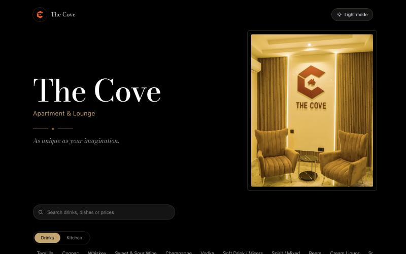
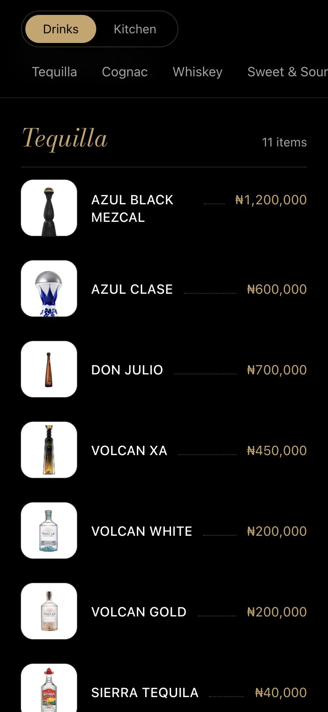
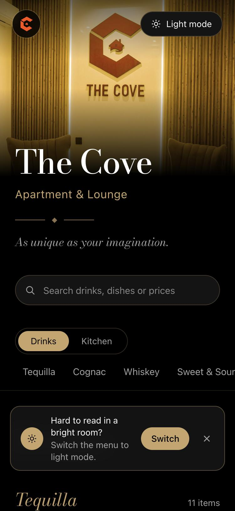
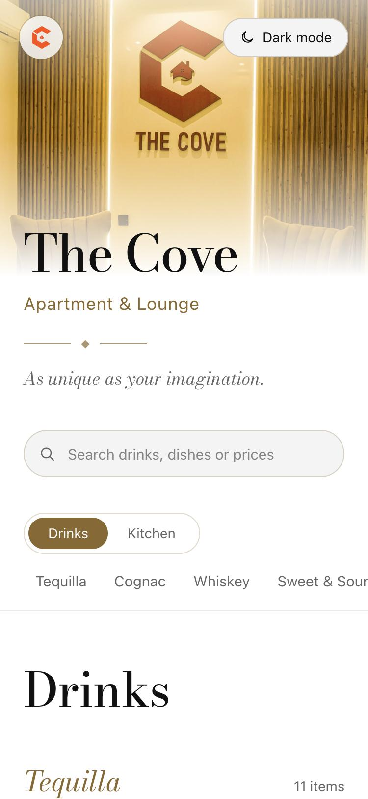

# The Cove — Digital Menu

A menu that feels like the lounge it belongs to. Guests at **The Cove Apartment & Lounge** scan, browse and order from their phones; staff update prices and photos in seconds.

**[See it live →](https://the-cove.vercel.app)**

  
  &nbsp;
  
  &nbsp;
  

## What makes it special

- **Designed, not templated.** High-contrast Bodoni type, brass accents and a printed-menu layout with dotted price leaders, built around the lounge's own gold-lit interior.
- **Made for a phone in a dim room.** A sticky Drinks / Kitchen switch, category tabs that follow you as you scroll, instant search, and tap-to-enlarge photos.
- **Light and dark mode.** Dark by default, with a gentle nudge to switch when the room is bright. Each guest's choice is remembered.
- **Always up to date.** Staff sign in to a private dashboard to add items, change prices and upload photos, and every edit shows exactly what's changing before it's saved. Updates go live instantly.
- **Never blank.** If the database is ever unreachable, the menu falls back to a built-in copy.

## Built with

Next.js 15 · React 19 · Tailwind CSS 4 · Neon Postgres & Neon Auth · Drizzle ORM · Cloudflare R2

---

Want a menu like this for your business? **[Chat on WhatsApp](https://wa.me/2349090366306)**
